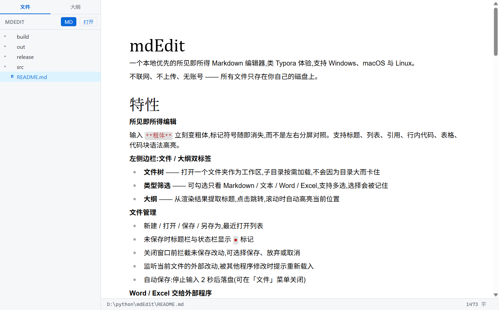

# mdEdit

一个本地优先的所见即所得 Markdown 编辑器,类 Typora 体验,支持 Windows、macOS 与 Linux。

文档默认保存在本地，无需账号。启用 AI 后，云端模型会收到问题、最近会话和检索片段；启用网页搜索时，问题也会发送给搜索服务。使用本地 Ollama 并关闭网页搜索时，问答可以在本机完成。



## 特性

**所见即所得编辑**

输入 `**粗体**` 立刻变粗体,标记符号随即消失,而不是左右分屏对照。支持标题、列表、引用、行内代码、表格、代码块语法高亮。

- **表格右键编辑** —— 在单元格上右键可向上 / 下插入行、向左 / 右插入列,以及删除当前行、列;与表格工具栏的加号按钮共用同一套命令
- **格式刷** —— 选中源文字后点浮动工具栏的刷子,再选中目标文字即可套用格式,支持粗体、斜体、删除线、行内代码和链接,`Esc` 取消。鼠标拖选会等选区稳定后一次性应用,不会在半截选区上提前生效
- **拖动即移动** —— 用鼠标左键把选中文字拖到别处是剪切而非复制,原位置文字会消失;拖入文件、块级拖动柄仍走各自原有行为

**左侧边栏:文件 / 大纲双标签**

- **文件树** —— 打开一个文件夹作为工作区,子目录按需加载,不会因为目录大而卡住
- **类型筛选** —— 可勾选只看 Markdown / 文本 / Word / Excel,支持多选,选择会被记住
- **大纲** —— 从渲染结果提取标题,点击跳转,滚动时自动高亮当前位置
- **整节拖动** —— 直接拖动大纲里的标题,把它和下面所有更深级标题、正文、表格作为一个整节搬到指定位置,层级保持不变,也不能拖进自己的子章节。代码块里的 `#` 不会被误判成标题

**文件管理**

- 新建 / 打开 / 保存 / 另存为,最近打开列表
- 未保存时标题栏与状态栏显示 `●` 标记
- 关闭窗口前拦截未保存改动,可选择保存、放弃或取消
- 监听当前文件的外部改动,被其他程序修改时提示重新载入
- 自动保存:停止输入 2 秒后落盘(可在「文件」菜单关闭)
- **记住阅读进度** —— 按文件保存滚动比例与光标位置,重新打开同一文件时自动回到上次读到的地方;停止滚动 500ms 写盘,切换 / 新建 / 删除 / 关窗前也会保存
- **双击打开跟随当前文件** —— 通过文件关联双击 `.md` 等文件启动时,文件树以该文件所在目录重建,不会沿用上次记住的无关工作区

**Word / Excel 交给外部程序**

`.doc` `.docx` `.xls` `.xlsx` `.csv` 无法在应用内编辑,点击后弹出打开方式菜单,可用默认程序打开或指定其他应用,用过的应用会被记住。

**查找替换**(`Ctrl+F`)

全文高亮所有匹配,当前项单独着色,支持上一个 / 下一个(首尾环绕)、替换当前、全部替换。

**Markdown 与纯文本互转**

「文件 → 导出」下的两项都会另存为新文件,不接管正在编辑的文档,原文件与未保存状态都不受影响。

- **导出为纯文本** —— 剥掉行内标记,但把结构留在文字里:标题带层级编号(`1` / `1.1` / `1.1.1`),一二级另加下划线;列表保留前缀与缩进,任务列表保留勾选;表格按显示宽度补空格对齐;链接保留地址。用记事本打开也读得出层次。
- **转换为 Markdown** —— 反过来识别纯文本里的结构:孤立的短行升级为标题(带 `1.2` 这类编号的按编号定级),`•` `·` 等符号以及 `(1)` `一、` 编号转成标准列表,四空格缩进块转成围栏代码块。

后者是启发式识别,对排版随意的文本可能判错;已经是 Markdown 的部分会原样保留,重复执行不会越改越乱。

**保存不改写你的原有格式**

这是本项目着力处理的一点。所见即所得编辑器在保存时会重新序列化整篇文档,很容易把你原来的写法改掉。mdEdit 做了这些约束:

- 列表符号固定用 `-`,不会被改成 `*`
- 空行就是空行,不会被写成 `<br />`
- 文末换行数量统一,**打开后直接保存不会产生任何改动**
- 表格按字符的显示宽度对齐(中日韩字符计 2 列),中文表格源码也能对齐:

```markdown
| 里程碑 | 内容             | 状态 |
| ------ | ---------------- | ---- |
| M1     | 脚手架           | 完成 |
| M3     | 文件读写与文件树 | 完成 |
```

## AI 本地文档多轮问答

通过「AI → AI 助手」或 `Ctrl+Shift+A` 打开面板，在配置中填写供应商、模型和 API Key。OpenRouter 默认模型为 `openrouter/free`，也可以手动指定模型。选择工作区后，可直接提问并继续追问，例如「这个项目什么时候验收？」→「它的负责人是谁？」。

首次使用可先点击「测试连接」，确认模型能返回内容后再保存配置。测试最长等待 15 秒，可点击停止；仅向当前模型发送固定的短请求，不携带笔记、会话或个人偏好，不写入历史，也不会自动保存正在编辑的配置。云端测试可能产生少量费用。修改供应商、模型、Key 或地址后需重新测试；失败时会提示凭据、接口、额度或本机 Ollama 检查方向。

- 每次请求携带最近最多 6 轮成功问答，并把追问改写成独立检索问题；上下文另有 24000 字符预算。
- 会话及每轮来源以明文保存在本机，按工作区隔离，每个会话最多保留 30 轮。「新对话」保留旧会话，支持切换、改名、删除及 Markdown 导出；最多新建 50 个会话。
- 工作区检索支持 `.md`、`.markdown`、`.mdown`、`.mkd` 和 `.txt`；隐藏目录、构建目录及超过 2 MB 的文件跳过。工作区仅检索磁盘内容。
- 问答范围可切换为「当前文档」或「当前选区」，发送时读取编辑快照；未保存内容需明确勾选才能发送。选区模式仅传所选文字，不附带整篇文档。快照片段随会话保存在本机，不会写回原文件。
- 当前文档最多 60000 字符，短文档完整传入，超过 12000 字符时选取最多 6 个片段（全文总结按分布采样，可能遗漏细节）；选区最多 12000 字符。
- 来源展示标题和行号，回答中的有效 `[1]` 等编号可点击定位原文；内容变化时报告部分匹配或无法定位。编辑快照只在文档和内容仍一致时定位。
- 启用资料检索但完全未命中时，直接说明依据不足，不调用模型生成猜测答案；已命中资料但缺少所问事实、或资料冲突时，提示词要求明确说明缺失和冲突，仍需人工核对。
- 可停止生成，失败或取消的轮次不会加入上下文。点击本地来源会在 mdEdit 内打开。
- 回答以流式展示，支持 Markdown 标题、列表、表格、代码块和链接；取消或中断后保留已生成部分并标注不完整，仅保留在当前界面，不写入会话历史。
- 本地检索状态面板显示 RAG 连接、嵌入器、索引工作区、块数和构建进度；支持手动刷新，面板可见时自动检查状态，并展示本轮检索模式和降级提示。
- 对回答缺失引用或引用了不存在的编号显示提示；这仅检查编号，尚不能自动验证每条结论与引用内容是否一致。
- API Key 保存时使用系统安全存储加密；安全存储不可用时会提示保存失败，仍可在当前面板临时使用。
- 安装包内置 BM25 + 哈希向量检索程序，自动启动，无需系统 Python、torch 或模型下载。每次查询核对文件指纹，故障时回退关键词检索，支持查看状态及重启。哈希向量不是语义模型，对无词面重叠改写的检索能力有限。

安装后选择云端模型并填写自己的 API Key，或连接已运行的本机 Ollama，即可问答。应用不附赠模型额度，也不预装 Ollama 或聊天模型。可选语义检索配置见 [rag-service/README.md](rag-service/README.md)。尚未支持 Word/PDF 摄取。回答中的 HTML 作为文本显示，图片不自动加载，外部链接需点击后打开。

### 回答模式与网页补充

默认是**智能助手（按需调用工具）**：由模型决定何时检索本地笔记、按引用编号继续读原文、搜网页，信息不足时可补查或反问，然后流式给出回答。工具调用使用 OpenAI 兼容的 function calling，所选模型必须支持；供应商拒绝时会展示错误，不会伪装成已执行检索。学习路线、概念解释可直接使用模型通用知识，公司内部事实仍须有本轮本地证据。本轮工具执行记录可展开查看，不随会话持久化；每轮最多 6 次模型决策、10 次工具调用，整体 120 秒。详见 [默认智能助手](docs/ai-agent-loop.md)。

也可切换为固定模式：

- **笔记问答**：仅依据本轮笔记、文档或选区；未找到资料时明确说明。
- **笔记 + 网页补充**：把检索问题发送给公共搜索引擎，读取最多 3 个公共网页正文并选取相关片段。网页引用可点击，标记正文/搜索摘要，鼠标悬停可查看获取时间。正文读取失败时退回搜索摘要并提示；无结果时不伪造来源。
- **通用问答**：使用模型知识与会话，不发送文档快照，不检索笔记或网页。

rc.3 将联网选项独立显示为「联网搜索＋文档（每轮实时检索）」，切换后记住选择，不必重新保存模型 Key。该模式即使已有本地命中也会每轮发起网页搜索，再按问题相关性去重排序，联合选取最多 8 个片段（其中最多 3 个网页，保留文档和网页两类来源）。这里的筛选是词面相关性排序，最终回答由模型对照资料生成，不能替代事实核验。

每轮回答显示文档片段数、联网候选数、最终网页数、正文/摘要数量和搜索时间；鼠标悬停可查看实际联网查询及引擎状态。未启用、搜索失败、无相关结果分别展示，状态随会话保存并可导出。网页搜索时间不是网页发布日期，不保证搜索索引中的内容就是最新事实。

例如笔记没有 RAG 定义时，可切换「笔记 + 网页补充」查找并引用网页，或用「通用问答」了解概念。公共搜索可能受网络、验证码和站点访问限制，网页和回答仍需核对。

### 本机偏好与隐私

「个人偏好与隐私」提供可编辑的 `preferences.md` 并显示实际路径，文件位于应用用户数据目录 `ai/` 下，可直接用 Markdown 编辑器维护。启用个性化时，偏好会随问题发送给所选模型，仅用于语言、长度和组织方式，不作为事实来源。

- 仅从明确的长期风格请求自动学习，例如「请以后简洁回答」「以后用英文回答」「我喜欢用列表回答」。不分析笔记、网页或助手回答，不推断身份，不调用额外模型做画像；临时的「请简洁回答这个问题」不自动记录。复杂偏好可手动填写。
- 可关闭个性化、关闭自动学习、撤销最近一次自动更新，或清空偏好。文件版本校验避免旧界面覆盖外部修改；撤销记录仅在当前应用进程保留。
- 关闭保存会话后，后续问答只在当前窗口内存保留，重启不加载历史。已有记录可主动「清除全部本机会话」，包含引用快照，不删除笔记、API Key 或偏好。
- 「仅本机模型」由主进程限制为 localhost/127.0.0.1/::1 的 Ollama 或自定义接口，并禁用网页搜索。模型接口不接受重定向；本机模型服务自身的网络行为需自行配置。
- 云端问答发送问题、最近最多 6 轮问答、本轮资料及启用的偏好。API Key 使用系统安全存储加密，会话与偏好没有加密。

安装与隐私说明见 [本机 AI 使用与验证](docs/ai-local-product.md)。

真实 OpenRouter 测试脚本为 `scripts/ai-smoke.cjs`：通过标准输入提供 Key，执行三轮合成文档问答。可把 Python 解释器路径作为第一个参数，自动启动并清理独立测试服务。脚本不保存 Key，不发送用户工作区文档。

无答案与引用边界说明见 [AI 下一版验证记录](docs/ai-grounding.md)。

## 下载

前往 [Releases](https://github.com/Eoneanyna/mdEdit/releases) 页面下载。

| 系统 | 文件 | 说明 |
| --- | --- | --- |
| Windows | `mdEdit-<版本>-win-x64.exe` | NSIS 安装包,可自选安装目录 |
| macOS | `mdEdit-<版本>-mac-x64.dmg` | Intel 芯片 |
| macOS | `mdEdit-<版本>-mac-arm64.dmg` | Apple Silicon |
| Linux | `mdEdit-<版本>-linux-x86_64.AppImage` | 免安装,`chmod +x` 后直接运行 |
| Linux | `mdEdit-<版本>-linux-amd64.deb` | Debian / Ubuntu |

> **说明**:目前仅提供 Windows 安装包。macOS 与 Linux 的产物需自行构建 —— macOS 的 `.dmg` 受签名机制限制,**必须在 macOS 上打包**,无法交叉编译。构建方式见下文。

## 技术栈

| 层 | 选型 | 为什么 |
| --- | --- | --- |
| 桌面外壳 | [Electron](https://www.electronjs.org/) 43 | 内置 Chromium,三平台渲染一致。Tauri / Wails 体积更小,但在 Linux 上依赖系统 webkit2gtk,对这类重排版应用的样式差异代价过高 |
| 编辑器内核 | [@milkdown/crepe](https://milkdown.dev/) 7(基于 ProseMirror) | 结构化文档模型,真正的所见即所得;而非 CodeMirror 那种「纯文本 + 装饰」的路线 |
| 构建 | [electron-vite](https://electron-vite.org/) 5 + Vite 7 | 主进程 / 预加载 / 渲染层统一配置,渲染层 HMR 开箱即用 |
| 打包 | [electron-builder](https://www.electron.build/) 26 | 一套配置产出三平台安装包 |
| 语言 | TypeScript 7 | 主进程与渲染进程分别用独立的 tsconfig,渲染层不引入 Node 类型以防误用 |
| 文件监听 | [chokidar](https://github.com/paulmillr/chokidar) 5 | 检测当前文件的外部改动 |

**安全约定**:渲染进程禁用 `nodeIntegration`、启用 `contextIsolation`,所有文件操作经由 IPC 交给主进程;主进程把异常收敛为 `Result` 类型,不把异常栈透给渲染层。

## 从源码构建

需要 Node.js 20 或更高版本。生成安装包另需 Python 3.10+（仅构建机需要）；内置检索必须在目标操作系统和架构上构建。

```bash
git clone https://github.com/Eoneanyna/mdEdit.git
cd mdEdit
npm install
```

开发模式(带热更新):

```bash
npm run dev
```

打包(**只能在对应系统上执行**):

```bash
npm run build:win     # Windows -> release/*.exe
npm run build:mac     # macOS   -> release/*.dmg
npm run build:linux   # Linux   -> release/*.AppImage, *.deb
```

其他命令:

```bash
npm run typecheck     # 主进程与渲染层分别做类型检查
npm run build         # 只编译,不打包
npm start             # 以生产模式预览
```

### 国内网络说明

Electron 与 electron-builder 的二进制默认从 GitHub Release 拉取,国内常超时。项目已在 [.npmrc](.npmrc) 与 [electron-builder.yml](electron-builder.yml) 中各配置了一份 npmmirror 镜像,正常情况下 `npm install` 与打包都能直接跑通,无需额外设置。

若使用 npm 12 及以后的版本,`.npmrc` 中的自定义配置项可能失效,届时改为导出环境变量即可:

```bash
export ELECTRON_MIRROR=https://npmmirror.com/mirrors/electron/
```

## 项目结构

```
src/
├── shared/ipc.ts          # 主进程与渲染进程共享的 IPC 契约与类型
├── main/                  # 主进程
│   ├── window.ts          #   窗口创建、关窗拦截
│   ├── menu.ts            #   原生菜单(含最近打开、自动保存开关)
│   ├── store.ts           #   配置持久化(工作区、最近文件、筛选、外部应用、阅读进度)
│   └── ipc/               #   文件读写、目录扫描、外部程序启动、文件监听
├── preload/index.ts       # contextBridge 白名单
└── renderer/src/          # 渲染层
    ├── editor/            #   编辑器封装、表格右键、格式刷、拖动移动、序列化约束
    ├── sidebar/           #   文件树、打开方式菜单
    ├── outline/           #   大纲面板、整节移动
    ├── search/            #   查找替换(ProseMirror 插件 + 界面)
    ├── state/             #   文档状态机、字数统计
    └── ui/                #   通用浮层菜单
```

## 已知限制

- **查找不跨样式边界** —— 形如 `重**点**` 的文本在文档模型里是两个节点,搜索"重点"不会命中
- **表格分隔行会被规范化** —— `| --- |` 会按列宽变成 `| ------ |`。这是 Markdown 序列化器的固有行为,配置无法关闭;好在它合法、渲染一致,且反复保存内容稳定
- **`.txt` 按 Markdown 解析** —— 若纯文本里恰好含有 `#`、`*` 等字符,保存后可能被转成对应的 Markdown 语法
- **安装包约 133 MB** —— Electron 运行时占绝大部分,另含内置检索程序与图标资源

## 协议

[MIT](LICENSE)

## 作者

cxy · [adc.rabbit@foxmail.com](mailto:adc.rabbit@foxmail.com)

问题与建议欢迎提到 [Issues](https://github.com/Eoneanyna/mdEdit/issues)。
